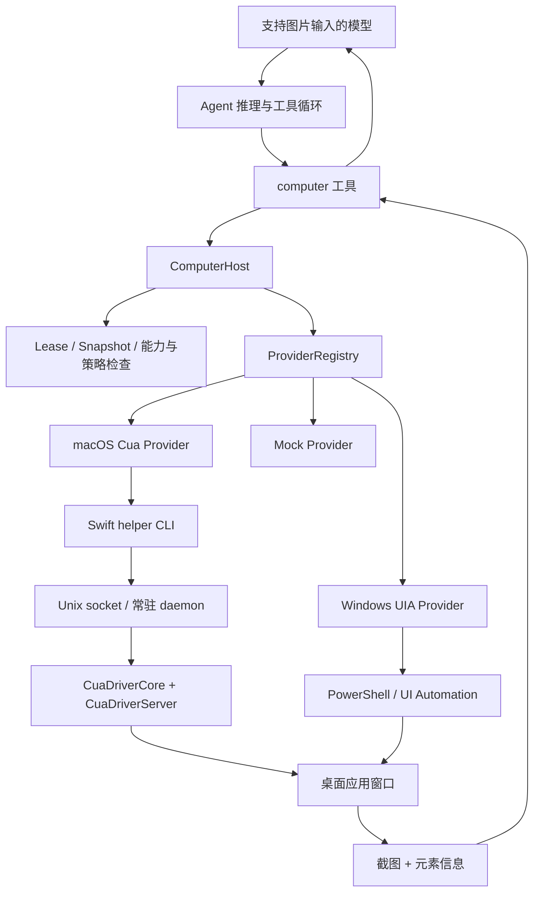

# OpenHanako Computer Use 源码分析与 Go / Eino 接入建议

分析日期：2026-10-29。

OpenHanako 基线：[main 提交 9a6cabf8c513db5edc6cf8179a538c9075885c6e](https://github.com/liliMozi/openhanako/commit/9a6cabf8c513db5edc6cf8179a538c9075885c6e)。通过 GitHub API 获取并阅读了该提交的核心模块、工具入口、Engine / Agent 接线、Swift helper、构建补丁及四组相关测试源码。

本文区分“源码现有行为”和“Go 版建议”。这是静态代码分析，没有启动 helper、操作桌面或验证具体应用兼容性。当前工作区的 `go.mod` 只有模块名，尚未选择 Eino 版本；Eino 部分对照的是分析时的官方 main 源码，不代表某个已锁定发行版。

## 1. 主要结论

OpenHanako 的 computer-use 是一套应用窗口控制基础设施：模型读截图和无障碍元素，然后通过普通工具调用发出动作。模型推理循环位于外层 Agent；`core/computer-use` 负责控制目标、状态、策略与平台执行。

- macOS：TypeScript Provider 调用 Swift CLI，CLI 经 Unix domain socket 访问常驻 daemon；真正的无障碍读取、窗口截图和进程定向输入来自 `trycua/cua`。
- Windows：TypeScript Provider 启动 PowerShell helper，以 .NET UI Automation 读取和操作元素。
- Linux：虽然存在 `mock` 默认 Provider 配置，产品运行时明确只支持 macOS / Windows；Mock 不提供真实 Linux 桌面控制。
- 模型主要操作元素编号。当前工具禁止坐标点击、双击、拖拽；无障碍树未暴露目标时，当前实现的覆盖范围会受限。

对于 Go 版本，建议先用 Go 实现 Host、Lease、Snapshot 和 Eino 工具适配，macOS 复用原生 helper。是否把原生控制层也改为 Go，需要单独决定。

## 2. 调用链和代码分工



| 代码 | 职责 |
| --- | --- |
| `core/engine.ts` 的 `_ensureComputerRuntime()` | 创建注册表、注册三种 Provider、构造共享 Host，注入设置与会话策略 |
| `core/agent.ts` 的 `_getComputerUseTool()` | 将工具挂入 Agent，提供模型、身份、审批和事件回调 |
| `lib/tools/computer-use-tool.ts` | 模型可见 schema、action 分发、应用授权、图片与文本结果、UI overlay 事件 |
| `computer-host.ts` | 统一入口：运行条件、Provider 选择、租约切换、快照与动作校验 |
| `lease-registry.ts` | 内存中的租约及快照记录、归属检查、最新快照检查 |
| `provider-contract.ts` / `provider-registry.ts` | 能力默认值、Provider 选择与注册 |
| `providers/macos-cua-provider.ts` | CLI 协议、daemon 生命周期、Cua 数据归一化、动作映射 |
| `providers/windows-uia-provider.ts` | PowerShell helper 管理、请求与结果文件、UIA 结果归一化 |
| `providers/windows-uia-script.ts` | 真正的 Windows 无障碍树遍历、截图与语义动作 |
| `desktop/native/HanaComputerUseHelper` | 对 Cua Swift 库的可执行程序封装、AppKit run loop 与 socket 服务 |
| `scripts/build-computer-use-helper.mjs` | 编译前修改上游 Cua 的树遍历和点击行为 |

核心入口：[Engine](https://github.com/liliMozi/openhanako/blob/9a6cabf8c513db5edc6cf8179a538c9075885c6e/core/engine.ts#L1835)、[Agent](https://github.com/liliMozi/openhanako/blob/9a6cabf8c513db5edc6cf8179a538c9075885c6e/core/agent.ts#L970)、[Tool](https://github.com/liliMozi/openhanako/blob/9a6cabf8c513db5edc6cf8179a538c9075885c6e/lib/tools/computer-use-tool.ts#L528)。

## 3. 一次任务如何运行

模型面对一个名为 `computer` 的工具，通过 `action` 区分操作：

| action | 行为 |
| --- | --- |
| `status` | 查看运行配置、Provider 和当前租约 |
| `list_apps` | 获取应用 / 窗口列表 |
| `start` | 解析应用标识、完成必要授权，创建或复用控制租约 |
| `get_app_state` | 获取目标窗口截图和元素，产生新快照 |
| `click_element` | 点击当前快照中的元素 |
| `type_text` | 向指定元素或应用当前输入目标写文本，具体取决于平台 |
| `press_key` | 定向按键；Windows 当前不支持 |
| `scroll` | 滚动指定元素或输入目标，具体取决于平台 |
| `perform_secondary_action` | 次级元素动作，macOS 映射到 `right_click` |
| `stop` | 停止控制、释放租约，并执行 Provider 清理 |

典型工具调用如下，标识符仅作示意：

```json
{"action":"start","appId":"com.apple.TextEdit"}
{"action":"get_app_state","leaseId":"L1"}
{"action":"click_element","leaseId":"L1","snapshotId":"S1","elementId":"12"}
{"action":"get_app_state","leaseId":"L1"}
{"action":"type_text","leaseId":"L1","snapshotId":"S2","elementId":"13","text":"hello"}
{"action":"get_app_state","leaseId":"L1"}
{"action":"stop","leaseId":"L1"}
```

这些是多个先后调用，不是现有工具支持的批量请求格式。`start` 本身不返回首张截图。动作完成后也不会自动读新状态，观察与结果确认由外层 Agent 继续发起。

`get_app_state` 的模型可见内容包括：leaseId、snapshotId、appId、windowId、简短操作指引、最多 60 条元素摘要和一张真实图片。完整元素列表及能力放在结果 `details` 中。图片通过 image content block 返回，不能将图片的 Base64 编码当普通文字返回来替代。

工具允许省略 leaseId / snapshotId，并从当前会话的活跃租约补齐。Go 版可以保留这项便利，但状态绑定必须在服务端完成。

## 4. Host 和租约解决什么问题

### 4.1 三个主要标识

| 标识 | 含义 | 使用边界 |
| --- | --- | --- |
| leaseId | 某个会话 / Agent 对应用窗口的控制记录 | 同时绑定 Provider、appId、windowId |
| snapshotId | 一次观察得到的状态版本 | 必须是该租约最近记录的快照 |
| elementId | 那次观察中的元素引用 | 不是永久 selector，刷新后需要重新确认 |

租约还包含 allowedActions、providerState、创建时间和状态。macOS 的 providerState 主要保存 PID / window ID；Windows 保存进程 / 窗口查找条件。

归属检查优先使用 sessionId，兼容 sessionPath，并比较 agentId。因此会话迁移路径后，稳定 sessionId 仍能识别原租约。

### 4.2 动作前的检查

`performAction()` 依次检查：运行开关与会话条件、图片输入模型、租约归属及活跃状态、快照是否最新、租约允许的动作、Provider 对应能力、elementId 是否存在于快照。随后将服务端保存的 `snapshotElement` 和 `snapshotDisplay` 传给 Provider。

这样 Provider 不必信任模型自己提供的元素标签、bounds 或 automationId。Windows 还会拿这些元数据与实时元素再次比对。

### 4.3 实际的独占与接管语义

设计目标是共享 Host 中只有一个活跃 computer lease。同一 owner 与同一目标再次 `start` 会复用；其他 owner 或其他目标发起 `start` 时，会先标记旧租约释放，再等待旧 Provider 的 stop / release，最后建立新租约。

这是“新请求接管”，不是“占用时拒绝”。租约也是应用层控制记录，不等于操作系统给窗口加锁，无法阻止用户手动操作窗口。

源码：[Host 动作入口](https://github.com/liliMozi/openhanako/blob/9a6cabf8c513db5edc6cf8179a538c9075885c6e/core/computer-use/computer-host.ts#L192)、[租约接管](https://github.com/liliMozi/openhanako/blob/9a6cabf8c513db5edc6cf8179a538c9075885c6e/core/computer-use/computer-host.ts#L360)、[快照校验](https://github.com/liliMozi/openhanako/blob/9a6cabf8c513db5edc6cf8179a538c9075885c6e/core/computer-use/lease-registry.ts#L152)。

## 5. macOS 的实现

### 5.1 依赖和进程结构

Swift 包要求 Swift tools 6.0、macOS 14，锁定 `trycua/cua` 的提交 `d38bfbfb6b1d4296903477f517b1a0fa54af497b`，依赖 `CuaDriverCore`、`CuaDriverServer` 和 MCP Swift SDK。

Provider 解析 helper 路径：显式环境变量、应用包内 helper、开发构建目录，最后才是外部 `cua-driver`。打包应用的 helper 路径具有权威性，缺失时不会悄悄改用其他外部驱动。

一次读取的实际命令形态是：

```text
hana-computer-use-helper get_window_state '{"pid":123,"window_id":456}' --raw --compact --socket <socket-path>
```

TypeScript 通过子进程取得 JSON；helper 将请求转为 `DaemonRequest(method: "call", name: ..., args: ...)`，经 Unix socket 发给 daemon。没有 daemon 时 helper 也能直接执行 ToolRegistry，但跨调用的元素缓存需要常驻进程。

因此不能只在 Go 中为每个操作启动一次完全独立的无状态 helper。`get_window_state` 产生的 element index 对应 Cua daemon 中缓存的 AXUIElement；后续 click 必须访问同一缓存。

OpenHanako 对自带 helper 自动启动 `serve`，轮询 `status`，默认启动等待上限 5 秒；普通命令默认 30 秒超时。helper 用 AppKit accessory application 和主线程 run loop 承载 daemon / 原生光标。自带 daemon 会在 stop / release / dispose 时清理。

源码：[Swift 包](https://github.com/liliMozi/openhanako/blob/9a6cabf8c513db5edc6cf8179a538c9075885c6e/desktop/native/HanaComputerUseHelper/Package.swift)、[helper 请求转发](https://github.com/liliMozi/openhanako/blob/9a6cabf8c513db5edc6cf8179a538c9075885c6e/desktop/native/HanaComputerUseHelper/Sources/HanaComputerUseHelper/main.swift#L92)、[Provider](https://github.com/liliMozi/openhanako/blob/9a6cabf8c513db5edc6cf8179a538c9075885c6e/core/computer-use/providers/macos-cua-provider.ts#L645)。

### 5.2 获取状态

Provider 调 `get_window_state(pid, window_id)`，提取 Cua 返回的图片、显示尺寸和元素信息。优先读取结构化 elements；没有时解析 tree_markdown 中的 `[编号] AXRole ... actions=[...]`，补充 label、enabled 和 actions。

编号通常转换成字符串；动作前再转回整数 `element_index`。Markdown 解析路径下 bounds 可以为空，不应假设每个元素必有几何位置。

锁定版本的 `WindowCapture` 使用 ScreenCaptureKit：从 SCShareableContent 定位指定窗口，以 SCContentFilter 配合 SCScreenshotManager.captureImage 截取，再按模型图片尺寸限制缩放。GetWindowStateTool 调用时选择 JPEG 编码；包装层保留驱动返回的 MIME type，所以不能假设 macOS 图片固定为 PNG。

### 5.3 真正的动作机制

继续阅读锁定版本的 Cua handlers，可以看到：

- `click_element` → `click(pid, window_id, element_index)` → 从缓存查 AXUIElement → 在 FocusGuard 中执行 AX action。默认 AXPress；OpenHanako 会根据元素声明改选 AXShowDefaultUI 或 AXOpen。
- `type_text` → 优先向目标设置 `AXSelectedText`；不支持时改走 `KeyboardInput.typeCharacters` 的进程定向字符输入。因此 Provider 的 `textInput: semantic` 描述并不意味着下层绝不合成键盘事件。
- `press_key` → `KeyboardInput.press`。OpenHanako 这里只传 PID / key，没有转发上游支持的元素编号、window_id 或 modifiers 参数。
- `scroll` → 锁定版本使用 PageUp / PageDown 或方向键进行滚动，可先对元素设置 AXFocused；它不是简单的滚轮事件模拟。
- 原生 agent cursor 是可视反馈，和真正用于触发操作的语义动作分开。

`KeyboardInput` 实际优先调用 `SkyLightEventPost.postToPid`，不可用时退回 `CGEvent.postToPid`。FocusGuard 则组合无障碍激活、窗口 / 元素合成焦点和前台恢复：如果目标应用响应 AX 操作而抢占前台，会尝试重新激活先前应用。因此后台控制依赖一组平台机制和兼容处理，不能解释成单个 AX 调用对所有应用都保证不切换焦点。若重写这层，SkyLight SPI 路径及其兼容性也是工作量的一部分。

原生核心：[WindowCapture](https://github.com/trycua/cua/blob/d38bfbfb6b1d4296903477f517b1a0fa54af497b/libs/cua-driver/Sources/CuaDriverCore/Capture/WindowCapture.swift)、[KeyboardInput](https://github.com/trycua/cua/blob/d38bfbfb6b1d4296903477f517b1a0fa54af497b/libs/cua-driver/Sources/CuaDriverCore/Input/KeyboardInput.swift)、[FocusGuard](https://github.com/trycua/cua/blob/d38bfbfb6b1d4296903477f517b1a0fa54af497b/libs/cua-driver/Sources/CuaDriverCore/Focus/FocusGuard.swift)。

上游代码：[ClickTool](https://github.com/trycua/cua/blob/d38bfbfb6b1d4296903477f517b1a0fa54af497b/libs/cua-driver/Sources/CuaDriverServer/Tools/ClickTool.swift)、[TypeTextTool](https://github.com/trycua/cua/blob/d38bfbfb6b1d4296903477f517b1a0fa54af497b/libs/cua-driver/Sources/CuaDriverServer/Tools/TypeTextTool.swift)、[ScrollTool](https://github.com/trycua/cua/blob/d38bfbfb6b1d4296903477f517b1a0fa54af497b/libs/cua-driver/Sources/CuaDriverServer/Tools/ScrollTool.swift)。

### 5.4 构建补丁不能漏看

OpenHanako 在编译前直接修改依赖 checkout：

1. 给 AX 查询设置 0.35 秒 messaging timeout。
2. 树深度从 25 限为 6，最多索引 48 个可操作元素。
3. 只对 Chromium / Electron 触发无障碍激活，避免对其他应用盲目写入相关属性。
4. 为没有标签的 AXRow 汇总子节点文字。
5. 为 ClickTool 加入 AXShowDefaultUI 的 schema 与动作映射。

因此直接安装任意版本的 cua-driver，并不等价于运行 OpenHanako 打包的 helper。48 元素上限也是性能与覆盖范围之间的取舍，只适用于经过该补丁的构建。

源码：[构建补丁](https://github.com/liliMozi/openhanako/blob/9a6cabf8c513db5edc6cf8179a538c9075885c6e/scripts/build-computer-use-helper.mjs#L73)。

## 6. Windows 的实现

Provider 把内嵌 PowerShell 脚本按内容哈希写入临时目录，每次调用生成独立 request.json / result.json，再使用 PowerShell `-File` 执行。结果以 UTF-8 无 BOM 写入临时文件，完成后 move 到结果路径，避免半写入 JSON；随后清理请求和结果文件。

采用结果文件能绕开 PowerShell stdout 的噪声，也不必把大图片结果塞进命令行。默认结果大小上限为 32 MiB。

底层加载 UIAutomationClient / UIAutomationTypes：

- 从 RootElement 找窗口，可按 window handle、PID 或标题匹配。
- 用 ControlViewWalker 广度优先遍历，最多收集 400 个节点，生成 `uia:0`、`uia:1` 等临时编号。
- 保存 role、Name、Value、enabled、bounds、automationId、nativeWindowHandle 与支持的 patterns。
- 点击依次尝试 Invoke、SelectionItem、Toggle、ExpandCollapse；输入用 ValuePattern.SetValue；滚动用 ScrollPattern。
- 每次动作重新查实时元素，并比较快照中的 role、automationId、label、handle；缺少稳定文字时用 bounds 做补充检查。
- 不支持的动作直接报告需前台或能力不支持，没有自动使用 SendInput 降级。

Windows 当前允许的动作只有 click_element、type_text、scroll、stop；输入和滚动要求 elementId。这里的 `start` 主要建立目标记录，不包含 macOS `launch_app` 那样的启动应用流程。

截图是按窗口 bounds 调用 `Graphics.CopyFromScreen`，再缩小至最长边不超过 1568 像素。这抓的是屏幕对应区域，不能保证被其他窗口遮挡或最小化的目标仍有正确图像。也就是说，“UIA 可以后台执行”不等于“后台截图一定可靠”。

源码：[Windows Provider](https://github.com/liliMozi/openhanako/blob/9a6cabf8c513db5edc6cf8179a538c9075885c6e/core/computer-use/providers/windows-uia-provider.ts#L347)、[截图和遍历](https://github.com/liliMozi/openhanako/blob/9a6cabf8c513db5edc6cf8179a538c9075885c6e/core/computer-use/providers/windows-uia-script.ts#L102)、[UIA 动作](https://github.com/liliMozi/openhanako/blob/9a6cabf8c513db5edc6cf8179a538c9075885c6e/core/computer-use/providers/windows-uia-script.ts#L293)。

## 7. 应用授权、模型和界面反馈

默认全局关闭。运行入口还检查主 Agent 限制和只读会话；创建真实桌面控制租约需要应用授权，isolated Mock 可以跳过。现有工具根据会话模式采用已有应用批准记录、Operate 会话批准、Auto reviewer 或 Ask 用户确认。

这套授权逻辑属于 OpenHanako 的产品策略，Go 库可以抽象成宿主提供的 Policy 接口，不必搬运它整套确认 UI。

模型支持检查仅要求可直接输入图片，不是绑定某一家厂商的专用 computer-use API。即使 Windows 声明 semantic-only observation mode，Host 的相关入口仍检查图片输入能力，当前正常状态归一化也要求截图。

工具还发出 computer_overlay 的 running / done / error 等事件，供 Electron UI 或原生 cursor 展示执行状态。它们不承担动作定位，也不构成停止正在执行的系统调用的机制。

## 8. 移植前应处理的具体边界

以下来自静态阅读，需要在目标应用上做集成验证；不要把 Provider 声明的 backgroundControl 等同于每个应用的实测保证。

| 源码行为 | Go 版建议 |
| --- | --- |
| Host 对 create / observe / act 没有显式互斥；单活跃租约依赖调用顺序 | 在桌面执行器串行化状态与动作，原子处理租约接管；Map 加锁本身不足以解决观察与执行竞态 |
| STALE_SNAPSHOT 校验只比较已记录版本；动作后不会自动失效，也没有时间 TTL | 动作后标记需刷新，或返回新的观察；为快照设置寿命和 generation |
| 租约含 expiresAt 字段，但活跃检查不执行到期判断 | 如提供 TTL，就实际强制执行 |
| 快照 Map 保留图片和历史记录，释放租约不删除快照 | 限制历史数量及图片大小，释放时清理 |
| 工具 execute 的 `_signal` 没有传入 Host / runner；abortSession 只修改租约记录 | 全链路传递 context.Context；区分取消 CLI 与取消 daemon 内动作；超时后可能需要重新观察确认效果 |
| macOS 多处只返回 getStructured(...)，否则返回 `{ok:true}` | 保留原始文字、警告与实际执行路径；锁定 Cua 的 ClickTool 可能在非错误文本中提示动作无效果，这些信息目前会丢失 |
| 应用审批主要在建立新租约时检查，后续动作不重新检查 app_approvals | 如果支持即时撤销，应同步终止现有租约或每次复核策略 |
| 上游锁定 Swift 版本支持 capture_mode=ax / vision / som，包装层又要求截图且依赖元素索引 | 启动时核对配置：ax 无图片会被包装层拒绝；vision 无树不适合当前元素动作；兼容测试应覆盖配置 |
| Windows Scroll-Element 计算了 amount 对应的 `$n`，但后续只做一次 LargeIncrement / LargeDecrement | 明确定义滚动单位，并让 amount 真正生效 |

其中，“动作后自动刷新”和“更严格的独占 / 取消”是 Go 版设计建议，不能误认为原项目已实现。

## 9. Go 实现的边界选择

| 方案 | Go 负责 | 原生依赖 | 适用情况 |
| --- | --- | --- | --- |
| Go Host + 现有 helper | 状态、策略、工具、进程管理、Eino 接入 | macOS Swift / Cua；Windows 可先保留 UIA helper | 先验证可用性，最接近现有实现 |
| Go Host + 自研原生桥 | 同上，以及稳定的原生桥协议 | macOS Objective-C / Swift / C bridge；Windows UIA / COM | 需要长期控制行为与打包方式 |
| Go 直接做屏幕坐标自动化 | 截图、坐标变换、输入事件 | 仍依赖操作系统 API / 平台绑定 | 以视觉点击为目标，是与原项目不同的动作策略 |

“主体使用 Go”不要求“每行代码都必须是 Go”。若要求完整复现 macOS 的后台输入，不能仅靠一个普通鼠标键盘封装推断工作量；上游还有元素缓存、焦点控制与进程定向事件投递。

建议先定义与 Eino 无关的边界。下面仅为设计草图，相关类型待定义，未作为可编译实现提交：

```go
type Provider interface {
    ID() string
    Capabilities() Capabilities
    Status(context.Context) (Status, error)
    ListApps(context.Context) ([]App, error)
    Start(context.Context, Target) (ProviderSession, error)
    Observe(context.Context, ProviderSession) (Observation, error)
    Act(context.Context, ProviderSession, ResolvedAction) (ActionResult, error)
    Stop(context.Context, ProviderSession) error
}
```

Host 管理 owner、lease、snapshot 和策略；Provider 只处理平台。`ResolvedAction` 携带 Host 查出的元素元数据，避免让模型构造可信定位信息。模型参数中不应允许自行声明会话 owner 或授权状态。

建议目录：`computer-use` 放公共模型和 Host，`providers/macos`、`providers/windows`、`providers/mock` 放平台实现，`adapters/eino` 放框架适配，`examples` 放一个窗口内输入并回读验证的端到端例子。

## 10. 接入 Eino 的关键点

Eino 官方 main 的 `components/tool/interface.go` 中，普通 `InvokableTool` 返回 string；另有 `EnhancedInvokableTool`，其 `InvokableRun(ctx, *schema.ToolArgument, ...tool.Option)` 返回 `*schema.ToolResult`，可携带文本和图片。`schema.ToolResult.Parts` 支持 `ToolPartTypeText` 和 `ToolPartTypeImage`。

因此若选择包含这套接口的 Eino 版本，观察工具优先实现 EnhancedInvokableTool，把元素摘要和截图放入同一个多模态结果。还需要验证所选 ChatModel adapter / 模型服务能正确处理这种工具图片消息。

如果项目使用的版本只有 string 工具结果，可由自定义 Graph 节点或模型输入转换层，将观察结果注入为该模型支持的图片消息。不能把 Base64 放进 JSON 字符串就认为模型已经看到了图片。

工具可以先保持 OpenHanako 的单一 `computer(action=...)` 入口；如果后续拆成 observe / click / type 等工具，应使用各自动作的严格 schema，并共享同一个 Host 与执行队列。

Eino 的 `ToolsNodeConfig.ExecuteSequentially` 默认 false，桌面工具应启用顺序执行；Host 自身仍要处理来自其他请求的并发。特别是 observe 和 click 之间发生另一次 observe，可能替换元素缓存，因此只对写动作加锁不够。

一个合适的 Eino Graph 是：模型决定下一步 → 工具节点执行 → 将多模态观察 / 结果回传模型 → 判断完成或继续，同时设置最大步数、整体 deadline，并在退出时清理租约。

官方接口：[tool/interface.go](https://github.com/cloudwego/eino/blob/main/components/tool/interface.go)、[schema/tool.go](https://github.com/cloudwego/eino/blob/main/schema/tool.go)、[compose/tool_node.go](https://github.com/cloudwego/eino/blob/main/compose/tool_node.go)。这些是 main 链接，开始编码时应选择并锁定具体版本。

## 11. 建议的第一版范围

1. 公共 Observation / Element / Action / Capabilities 类型、Host、内存租约与 Mock Provider。
2. macOS helper Provider：固定依赖版本，完成 status → list_apps → start → observe → 元素输入 → observe → stop。
3. Eino 多模态适配，确认模型实际收到图片和元素摘要。
4. 集成验证：指定窗口中输入文字并从下一次快照读回；检查前台应用是否被意外切换，停止后是否残留 daemon。
5. Windows Provider 另行验证 UIA 语义动作和截图遮挡问题。

首版最值得保留的是 Host / Provider 分层、元素与快照绑定、能力声明和可验证的观察循环。光标动画、Electron overlay 和 OpenHanako 的完整审批产品流程可以放在后续宿主集成阶段。

阅读到的测试覆盖了旧快照拒绝、Provider 能力校验、租约复用及接管、sessionId 路径迁移、应用批准、图片内容、daemon 启停、Windows 结果文件和语义动作限制。这些测试多使用 Mock / fake runner，不能据此推断真实 GUI 应用已兼容；本次也没有运行它们。
